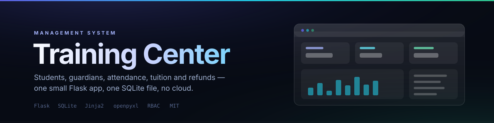

<div align="center">
  
</div>

<br>

<div align="center">

**The admin system a small training centre actually needs — students, attendance, tuition, refunds, reports.**

One Flask file. One SQLite database. No cloud, no build step, no monthly fee.

[](#requirements)
[](#requirements)
[](#data-model)
[](#why-one-file)
[](LICENSE)

[Features](#features) · [Roles](#roles-and-permissions) · [Quick start](#quick-start) · [Data model](#data-model) · [Security](#security-notes)

</div>

---

> [!CAUTION]
> **Three things must be done before this touches real student data.**
>
> **1. Set `FLASK_SECRET_KEY`.** The code falls back to a hard-coded default for that variable. Left unset, every installation shares the same signing key and session cookies can be forged. Export a long random value before starting.
>
> **2. Change the seeded passwords.** The first run creates two accounts — `admin` / `admin123` and `principal` / `principal123` — so a fresh install is usable offline. They are not passwords to leave on an office network.
>
> **3. Never commit `students.db` or `uploads/`.** They contain minors' names, guardians' phone numbers, payment records and student photographs. Both are git-ignored in this repository and **no database ships with it** — a fresh clone creates an empty one on first run.

---

## Why one file

A training centre with two hundred students does not need a service mesh. It needs something a teacher can start on the office PC, back up by copying a file, and understand six months later when the original author has moved on.

So the whole backend is `app.py` — 4,686 lines, no blueprints, no ORM, no migration framework beyond a small versioned schema step. Templates are server-rendered Jinja2 with plain CSS and vanilla JS: **no npm, no bundler, no node_modules**. Deployment is `pip install -r requirements.txt` and `python app.py`.

The trade-off is honest: this is not a multi-tenant SaaS, and the file is long. In exchange, a non-developer can run and back it up, and there is no dependency tree to rot.

---

## Features

| Module | What it does |
|---|---|
| **Student records** | Full student profile with an auto-generated student number, guardian contacts, enrolment history and status |
| **Student résumé** | Per-student portfolio of awards, projects and milestones, editable by staff and teachers |
| **Attendance** | Lesson-by-lesson attendance with per-student status and course roll-up |
| **Courses and subjects** | Course catalogue with subject grouping, pricing and lesson counts |
| **Teachers** | Teacher records, subject assignment and course ownership |
| **Tuition payments** | Payment entry against an enrolment, with proof-photo attachment and balance tracking |
| **Refunds** | Refund requests against a paid enrolment, with proof photo and approval trail |
| **Lesson hours** | Remaining-lesson accounting per enrolment, decremented by attendance |
| **Reports** | Enrolment, revenue and attendance statistics with date-range filtering |
| **Excel import** | Bulk student import from `.xlsx` via `openpyxl`, with validation and a dry-run report |
| **Audit log** | Every write operation recorded in `operation_logs` — who, what, when |
| **Role-based permissions** | Four roles with per-action permission checks on the server, not just hidden buttons |
| **Numbering rules** | Pluggable document numbers (student IDs, payment receipts) generated from the `counters` table |
| **Mobile layout** | Responsive templates, usable on a phone at the front desk |

Everything is server-enforced. Hiding a button is a convenience; the permission decorator is the actual boundary.

---

## Roles and permissions

| Role | Scope |
|---|---|
| **admin** | Everything, including user accounts and system settings |
| **principal** | Everything operational — students, courses, payments, refunds, reports; cannot delete the admin |
| **staff** | Front-desk work: students, attendance, payments, refunds, résumés, subjects |
| **teacher** | Read student records, take attendance, edit résumés, view own courses |

Permission sets are declared as constants at the top of `app.py` (`STUDENT_WRITE_ROLES`, `PAYMENT_WRITE_ROLES`, `RESUME_WRITE_ROLES`, …). Every route sits behind `@login_required` and calls a small predicate such as `can_write_student(role)` before mutating, so adding a role means editing one constant instead of hunting for scattered `if`s.

---

## Quick start

### Requirements

- Python 3.9+
- `flask` and `openpyxl` — that is the entire dependency list

```bash
git clone https://github.com/13734795725zhao-rgb/training-center-mgmt.git
cd training-center-mgmt

pip install -r requirements.txt

# REQUIRED: use your own signing key
export FLASK_SECRET_KEY="$(python -c 'import secrets;print(secrets.token_urlsafe(48))')"   # Linux/macOS
# $env:FLASK_SECRET_KEY = "..."                                                             # PowerShell

python app.py
```

Open **http://127.0.0.1:5000/** and sign in.

The database `students.db` is created on first run and the schema is applied automatically. Create the first administrator from `/settings` after logging in with the seeded account, or seed one directly if you prefer.

### Production

`app.py` runs Flask's development server, which prints that warning for a reason. Behind a real deployment put it under a WSGI server and a TLS-terminating proxy:

```bash
pip install waitress
waitress-serve --listen=0.0.0.0:8000 app:app
```

Keep `students.db` and `uploads/` on backed-up storage — they are the entire system state.

---

## Data model

SQLite, 18 tables, single file:

```
users ─┬─ operation_logs          students ─┬─ enrollments ─┬─ attendance
       │                                    │               ├─ payments ── payment_photos
       └─ system_settings                  ├─ guardians     ├─ refunds ─── refund_photos
                                           ├─ photos        └─ resume_items
courses ─── subjects                       └─ (student_no from counters)
teachers ─── courses
```

| Table | Holds |
|---|---|
| `students` / `guardians` | Student profile and family contacts |
| `enrollments` | Student × course, with purchased lesson count and balance |
| `attendance` | Per-lesson, per-student status |
| `payments` / `refunds` | Money in and out, with proof images |
| `courses` / `subjects` / `teachers` | The catalogue |
| `resume_items` | Student portfolio entries |
| `operation_logs` | Append-only audit trail |
| `counters` | Document numbering sequences |
| `system_settings` | Editable instance configuration |

**Deleting a student is a hard delete of everything attached to them** — guardians, attendance, résumé items, photos, attachments, enrolments, and every payment and refund with its proof images. Nothing is soft-deleted; no financial row survives. That route is restricted to `admin` and `principal` for exactly this reason, and the audit log records the deletion.

---

## Security notes

- **`FLASK_SECRET_KEY`** — set it. The fallback value in `app.py` is a convenience for a first local run, not a secret.
- **`students.db` and `uploads/`** — personal data of minors. Git-ignored here, never committed, never shipped. If you fork this for your own centre, keep it that way and back up the file rather than the repository.
- **Passwords** are hashed with `werkzeug.security.generate_password_hash` (Werkzeug's default scrypt/PBKDF2), never stored in plain text.
- **Audit trail** — `operation_logs` records every write with the acting user, so a mistaken edit is traceable.
- **Intranet by default** — this is designed for an office LAN. If you expose it to the internet, put TLS in front of it and change the default port.

---

## Limitations

1. **Chinese-first UI.** Interface, templates, seed data and documentation are in Chinese. The code and this README are in English.
2. **Single-tenant, single-file.** One centre per deployment; no multi-branch consolidation.
3. **`app.py` is long.** 4,686 lines in one module is a deliberate trade for deployability, not an accident — but it does make `grep` your primary navigation tool.
4. **No automated test suite beyond `test_api.py`.** A 61-line API smoke script covers the auth and student endpoints; the rest is verified by hand.

---

## Documentation

| Document | Contents |
|---|---|
| [`docs/PRD.zh-CN.md`](docs/PRD.zh-CN.md) | Product requirements — module-by-module specs, numbering rules, the v3.4 permission model |
| [`docs/TECHNICAL-DESIGN.zh-CN.md`](docs/TECHNICAL-DESIGN.zh-CN.md) | Technical design — architecture, 18-table schema, auth, audit, cascade rules, migration |

---

## Contributing

Issues and pull requests are welcome.

- Never commit `students.db`, `uploads/` or `backups/`.
- Permission checks belong in the role constants plus the decorator, not in a template's ``.
- Keep the dependency list at two packages. A plugin system is not on the roadmap.
- If you add a schema change, bump the schema version and add the migration step — do not require a manual `ALTER TABLE`.

---

## License

[MIT](LICENSE) © 2026 幻蝶

---

<div align="center">
<sub>Small centres deserve software that fits on a USB stick.</sub>
</div>
